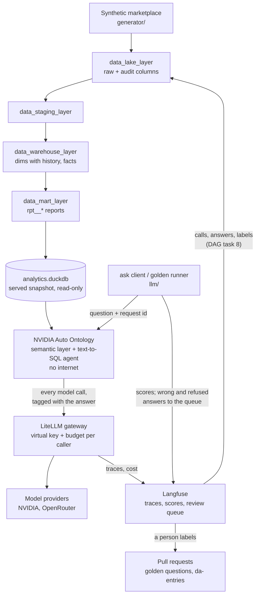
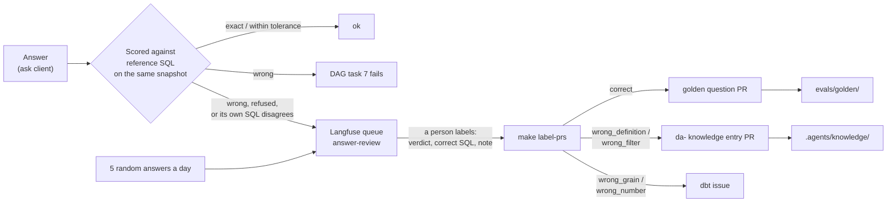

# project-agentic-data-warehouse

An end-to-end **agentic data warehouse** that runs on one laptop. A synthetic marketplace produces
data every day; DuckDB, dbt and Airflow turn it into a documented warehouse; NVIDIA Auto Ontology
answers business questions from a published snapshot; every model call goes through one LiteLLM
gateway and is traced in Langfuse; answers are scored against reference SQL, doubtful ones go to a
person, and that person's labels come back as pull requests that change the golden set and the
knowledge base. Coding agents build all of it under a written work loop that CI enforces.

Agents work at three levels here, and each is checked:

| Who | Does | Checked by |
|---|---|---|
| **Chat agent** (Auto Ontology) | answers "how many orders were cancelled on 2026-01-04?" with SQL on the snapshot | golden questions with reference SQL, every day; human labels on the doubtful ones |
| **Coding agent** (Claude Code) | adds models, checks, DAG tasks; opens one PR per issue | [AGENTS.md](AGENTS.md) loop, blocking CI checks, Codex review on every PR |
| **Person** | approves plans, labels answers, merges | nothing merges without them |

## What you can do with it

| Command | What happens |
|---|---|
| `make backfill FROM=2026-01-01 TO=2026-01-08` | One Airflow run per day: generate the day's source files, load the lake, build dbt, gate quality, publish the snapshot, record the run. Refreshing Auto Ontology and asking the golden questions need the `ontology` profile, landing the LLM telemetry needs `obs`; without them those tasks are skipped, which is fine (the quickstart below starts them after the backfill). Golden questions are asked on the last day (`TO`) only |
| `make ask Q="What was the net revenue on 2026-01-05?"` | One question to the chat, with a full answer trace in Langfuse: answer, SQL, rows, step trace, snapshot hash, and the exact model calls and cost behind it |
| `make golden DS=<day>` | Every golden question scored `exact_match`, `within_tolerance`, `wrong` or `refused`; a wrong answer fails the DAG task and lands in the review queue |
| `make label-prs OPEN=1` | Labels a person gave in the Langfuse queue become a pull request: a `correct` answer becomes a golden question, a `wrong_definition` becomes a `da-` knowledge entry, a `wrong_grain` becomes a dbt issue |
| `make compare-providers ALIASES=nvidia,openrouter` | The golden set once per model provider, as a Langfuse experiment, with a report of accuracy, cost per correct answer and p95 latency |
| `make checks` / `make test` / `make dbt-ci` | The governance checkers, the tests and the 3-day dbt build that CI runs |

From a fresh clone to a working chat: [docs/runbook.md](docs/runbook.md).

## Architecture



Airflow runs it all once a day as DAG `warehouse_daily`
([airflow/dags/warehouse_daily.py](airflow/dags/warehouse_daily.py)):

1. `generate_source`: the day's source files.
2. `load_lake`: replace the day's partition in `data_lake_layer`, with audit columns.
3. `dbt_build`: staging, warehouse and mart, with their tests.
4. `quality_gate`: dbt passed, the day landed, no empty business mart.
5. `publish_snapshot`: warehouse and mart into `analytics.duckdb`, row counts checked, atomic swap.
6. `refresh_ontology`: Auto Ontology picks up the new snapshot and compiles what changed.
7. `golden_questions`: every golden question asked and scored; a wrong answer fails the task.
8. `land_llm_telemetry`: gateway calls, Langfuse scores and answers into the lake, then the
   `ops` models.
9. `record_run`: one row in `ops.run_log`, whatever happened.

- **Data.** `generator/` writes a deterministic marketplace (shop, ledger, marketing): customers,
  sellers, products with price history, orders, payments, shipments, refunds, invoices,
  settlements, campaigns. It carries deliberate defects (duplicates, late rows, a renamed status,
  orphan keys), documented in [generator/DEFECTS.md](generator/DEFECTS.md), so the warehouse has
  something real to clean.
- **Warehouse.** dbt in four layers, one folder per table with its SQL, YAML and doc block
  (`dbt/models/data_{lake,staging,warehouse,mart}_layer/`): 19 lake sources, 19 staging models,
  17 warehouse models, 8 marts (one folder each in those four layer folders). Customer and product dimensions keep history (`valid_from_at`,
  `valid_to_at`). The `ops` domain models the platform itself: model spend, latency, answer
  quality, pipeline health, provider comparison.
- **Serving.** Only `data_warehouse_layer` and `data_mart_layer` reach the snapshot, comments
  included, so the documentation written in dbt becomes Auto Ontology's catalog.
- **Model calls.** Auto Ontology's containers sit on a Docker network with no route out; the
  gateway is the only way to a model, with a virtual key and a daily budget per caller
  ([infra/llm-gateway/budgets.yaml](infra/llm-gateway/budgets.yaml)).
- **Auto Ontology** runs at a pinned upstream commit plus three small overlay patches
  ([infra/auto-ontology/patches/](infra/auto-ontology/patches/)): read DuckDB comments, ask for
  SQL-only answers, tag every model call with the answer it serves.

### The feedback loop



Labels also land in the warehouse (task 8), so `rpt__ops__answer_quality__weekly` shows accuracy
and the verdict mix week by week.

## Tech stack

Every version is pinned in the repository; the source of each pin is in the last column.

| Layer | Tool | Version | Role | Pinned in |
|---|---|---|---|---|
| Language and packages | Python, uv | 3.12+ | every job, one locked environment | `pyproject.toml`, `uv.lock` |
| Storage | DuckDB | 1.5.x (1.5.5 loader, 1.5.4 inside dbt) | the build file and the served snapshot; one file format for every reader | [infra/duckdb-pins.yaml](infra/duckdb-pins.yaml), `check_duckdb_compat` |
| Transformation | dbt | 2.0.12 | staging, warehouse, mart, tests, docs persisted as comments | `pyproject.toml` |
| Orchestration | Apache Airflow | 3.3.2, LocalExecutor, Postgres 17.6 | DAG `warehouse_daily`, backfill | [airflow/Dockerfile](airflow/Dockerfile), [infra/compose.yml](infra/compose.yml) |
| Semantic layer and chat | NVIDIA Auto Ontology | upstream `f3c310c7a279` + 3 overlay patches | catalog, semantic compile, text-to-SQL agent, web UI | [infra/auto-ontology/UPSTREAM_SHA](infra/auto-ontology/UPSTREAM_SHA), [patches/](infra/auto-ontology/patches/) |
| Auto Ontology store | Postgres with pgvector | pg17 | catalog, embeddings | [infra/compose.yml](infra/compose.yml) |
| Model gateway | LiteLLM proxy | v1.110.2 | aliases, virtual keys, daily budgets, spend log | [infra/llm-gateway/](infra/llm-gateway/) |
| Tracing, scores, review | Langfuse (self-hosted) | 4.83.0, with ClickHouse 26.3, Redis 7.4.7, MinIO | traces, scores, annotation queue, datasets, experiments | [infra/compose.yml](infra/compose.yml), [infra/langfuse/](infra/langfuse/) |
| Edge and isolation | nginx, socket proxy | 1.28, 1.13.1 | the only published door to Auto Ontology; restarts allowed for exactly two containers | [infra/compose.yml](infra/compose.yml) |
| Containers | Docker Compose | profiles `core`, `obs`, `ontology` | start only what the day needs | [infra/compose.yml](infra/compose.yml) |
| CI | GitHub Actions, gitleaks | | tests, governance checkers, the 3-day dbt build | [.github/workflows/ci.yml](.github/workflows/ci.yml) |
| Coding agent | Claude Code, with Codex reviewing PRs | | builds the project under [AGENTS.md](AGENTS.md); harness registry in [.agents/harnesses.yaml](.agents/harnesses.yaml) | [.claude/settings.json](.claude/settings.json) |

Models, all reached through gateway aliases ([infra/llm-gateway/config.yaml](infra/llm-gateway/config.yaml)):

| Alias | Model | Used for |
|---|---|---|
| `openai/adw-reasoning` | NVIDIA Nemotron 3.5 Lightning 30B A3B (NVIDIA NIM) | Auto Ontology's reasoning role: the text-to-SQL agent, the semantic compile |
| `openai/adw-non-reasoning` | the same model, thinking off | quick classification and rewriting steps |
| `openai/adw-or-chat`, `openai/adw-or-non-reasoning` | the same model on OpenRouter | provider comparison |
| `adw-embed` | NVIDIA Nemotron 3 Embed 1B (2048 dimensions) | catalog and question embeddings |
| rerank pass-through | NVIDIA Nemotron 3.5 Rerank 8B | ranking catalog hits |

## Why it works

- **One door to every model.** Nothing calls a provider directly: Auto Ontology has no internet,
  and `check_gateway_only` fails CI if a provider host or key name appears outside the gateway's
  config. So every call is counted, priced, budgeted and traced, whoever makes it.
- **Truth is SQL, not a judge model.** A golden question carries reference SQL written by a
  person; the runner runs it on the same snapshot the chat answered from and compares the
  numbers. The answer's own SQL is re-run too (read-only, no file access), so an answer that
  misquotes its own result is caught.
- **Every call is tied to its answer.** The ask client sends the answer's id; Auto Ontology tags
  every chat, embedding and rerank call with it, so cost and latency per answer are exact, not
  guessed from a time window.
- **People decide, the repository remembers.** A label is not just a score: it becomes a pull
  request that passes the same checks as code, adding a golden question or a knowledge entry
  with the SQL behind every number.
- **The coding agent is governed, not trusted.** [AGENTS.md](AGENTS.md) sets the loop (plan in
  chat, wait for approval, one issue, one branch, one worknote, one PR, never merge) and five hard
  rules. CI blocks on naming, model bundles (YAML, doc, key test), layer reads, audit columns,
  gateway-only, secrets and home paths, knowledge freshness, golden questions, worknotes and the
  PR body, including an AI usage footer with the agent's own token cost.
- **Knowledge expires.** Each lesson in [.agents/knowledge/](.agents/knowledge/) has evidence that
  must still resolve and a verification date: data entries go stale after 90 days, engineering
  entries after 365. A retrieval test keeps them findable.
- **Everything is recorded.** `ops.run_log` has one row per day (tests, rows, snapshot hash,
  refresh, golden and telemetry outcome); every issue has a worknote with its decisions and the
  commands that proved it done ([docs/task-management/](docs/task-management/)).

## Strategy

How the project was built, and why in this order:

1. **Design first, then a spike.** [PLAN.md](PLAN.md) set the layers, naming, serving, gateway,
   tracing and milestones before any code; milestone M0 then verified every risky assumption
   (versions, file compatibility, request id passthrough, memory) with a command each, in
   [docs/m0-findings.md](docs/m0-findings.md). Several decisions changed on that evidence.
2. **Pin versions where tools meet.** dbt bundles its own DuckDB and Auto Ontology locks another,
   so the project stays on DuckDB 1.5.x and CI proves all three can open one file (decision D1).
3. **Govern the coding agent from day one.** The harness came before the warehouse (M1): the
   work loop, hooks, the activity log, the AI usage footer and the PR checks. Every later
   milestone was built by an agent inside those rails, one issue and one PR at a time.
4. **Data you can trust before data you can ask.** Generator (M2), lake with audit columns (M3),
   dbt with history (M4), checkers that block bad models (M5) and a knowledge base with expiry
   (M6) came before any chat.
5. **The gateway before the first model call.** LiteLLM and Langfuse (M8) were in place before
   Auto Ontology (M9), so its very first ingest was already counted, budgeted and traced.
6. **Measure before improving.** The golden runner (M10) and the human review loop (M11) came
   before tuning anything. That is how the main cause of refused answers was found from the
   traces alone, then fixed and measured (5 of 21 to 0 of 21).
7. **Consume upstream, don't fork it.** Auto Ontology runs at a pinned commit with small overlay
   patches applied at build time, so an upgrade is a new SHA plus a re-check of three patches.
8. **Local first, cheap to move later.** Everything runs on one laptop behind 127.0.0.1;
   [PLAN.md](PLAN.md) section 12 lists what keeps a later move to hosting cheap.

## Results so far

| What | Result | Source |
|---|---|---|
| Chat refusals on the golden set | 5 of 21 answers before, 0 of 21 after overlay patch 0002, no wrong answer in either | [docs/runs/refusals-20261122.md](docs/runs/refusals-20261122.md) |
| Why the chat refused | 10 of 13 refused answers used only the catalog view, whose tables never came into view for SQL | same report |
| Provider comparison, NVIDIA vs OpenRouter | two runs disagree (85.7% vs 28.6%, then 42.9% vs 57.1%), so no swap was proposed; OpenRouter's p95 latency was about a third of NVIDIA's | [docs/runs/compare-20261122T0958.md](docs/runs/compare-20261122T0958.md), [compare-20261122T1006.md](docs/runs/compare-20261122T1006.md) |
| Calls linked to their answer by id | 81 of 81 calls in a golden run's answer windows | [docs/task-management/36-request-id-tags.md](docs/task-management/36-request-id-tags.md) |
| dbt documentation in Auto Ontology's catalog | 16 of 16 table and 145 of 145 column descriptions (none before) | [docs/task-management/22-auto-ontology-serving.md](docs/task-management/22-auto-ontology-serving.md) |
| A wrong golden answer stops the day | task 7 failed, the answer was queued, the day recorded `failed` | [docs/task-management/26-golden-runner.md](docs/task-management/26-golden-runner.md) |
| A human label became knowledge | a `wrong_definition` label ("active customer") produced `da-0006` through a PR ([#30](https://github.com/fiqryrev/project-agentic-data-warehouse/pull/30)) | [docs/task-management/28-human-in-the-loop.md](docs/task-management/28-human-in-the-loop.md) |
| Fresh clone to a working chat | the runbook alone, ending in a passing `make ontology-check` | [docs/task-management/32-provider-comparison.md](docs/task-management/32-provider-comparison.md) |

## Repository map

| Path | What it holds |
|---|---|
| [PLAN.md](PLAN.md) | the design and the milestones |
| [AGENTS.md](AGENTS.md) | the map and work loop for coding agents |
| `generator/`, `loader/` | synthetic sources and the lake loader |
| `dbt/` | the warehouse models, one folder per table |
| `airflow/`, `publish/` | the daily DAG and its steps after dbt |
| `llm/` | ask client, golden runner, telemetry, label PRs, provider comparison, refusal diagnosis |
| `evals/golden/` | golden questions with reference SQL |
| `infra/` | compose profiles, gateway config and budgets, Langfuse score configs, Auto Ontology overlay |
| `helpers/`, `tests/` | governance checkers and tests |
| `.agents/` | rules, skills, the knowledge base, model prices for the AI usage footer |
| `docs/` | runbook, generated knowledge docs, run reports, one worknote per issue |

## Quickstart

You need Docker with at least 7.75 GiB for the VM (the three profiles use about 6 GiB,
[worknote 28](docs/task-management/28-human-in-the-loop.md)), [uv](https://docs.astral.sh/uv/),
and API keys for the model providers named in `.env.example`.

```bash
uv sync
uv run pytest -q
make up-core && make backfill FROM=2026-01-01 TO=2026-01-08
make up-obs && make up-ontology && make ontology-check
make ask Q="How many orders were placed on 2026-01-03?"
```

The full walk-through, with what each step prints and what to do when something is off, is in
[docs/runbook.md](docs/runbook.md).

## Status

Milestones M0 to M12 of [PLAN.md](PLAN.md) are merged:

| # | Milestone | PR |
|---|---|---|
| M0 | Spike: versions, file compatibility, gateway, tracing | [#3](https://github.com/fiqryrev/project-agentic-data-warehouse/pull/3) |
| M1 | Repository skeleton and agent harness | [#5](https://github.com/fiqryrev/project-agentic-data-warehouse/pull/5) |
| M2 | Deterministic source generator | [#7](https://github.com/fiqryrev/project-agentic-data-warehouse/pull/7) |
| M3 | Lake loader with audit columns | [#9](https://github.com/fiqryrev/project-agentic-data-warehouse/pull/9) |
| M4 | dbt project: staging, warehouse, mart, history | [#11](https://github.com/fiqryrev/project-agentic-data-warehouse/pull/11) |
| M5 | Governance checkers | [#13](https://github.com/fiqryrev/project-agentic-data-warehouse/pull/13) |
| M6 | Knowledge base | [#15](https://github.com/fiqryrev/project-agentic-data-warehouse/pull/15) |
| M7 | Airflow and `warehouse_daily`, run log, backfill | [#19](https://github.com/fiqryrev/project-agentic-data-warehouse/pull/19) |
| M8 | LLM gateway and Langfuse | [#21](https://github.com/fiqryrev/project-agentic-data-warehouse/pull/21) |
| M9 | Snapshot publish, Auto Ontology behind the gateway | [#23](https://github.com/fiqryrev/project-agentic-data-warehouse/pull/23) |
| M10 | Ask client, golden runner, DAG task 7 | [#27](https://github.com/fiqryrev/project-agentic-data-warehouse/pull/27) |
| M11 | Human-in-the-loop: label export, ops marts, label PRs | [#31](https://github.com/fiqryrev/project-agentic-data-warehouse/pull/31) |
| M12 | Provider comparison and runbook | [#33](https://github.com/fiqryrev/project-agentic-data-warehouse/pull/33) |

Since then: chat refusals fixed ([#35](https://github.com/fiqryrev/project-agentic-data-warehouse/pull/35)) and model calls linked by request id ([#37](https://github.com/fiqryrev/project-agentic-data-warehouse/pull/37)).

## Limits

- **Synthetic data.** The marketplace is generated; its defects are deliberate and documented.
- **Local only.** One laptop, ports on 127.0.0.1; no hosting, no multi-user setup.
- **Estimated NVIDIA prices.** LiteLLM has no price for the NVIDIA model, so the gateway uses the
  OpenRouter list price of the same model; OpenRouter costs are billed for real.
- **Auto Ontology is patched.** It runs at a pinned commit with three overlay patches applied at
  build time, not a fork.
- **Small golden set.** Eight questions; it grows from human labels.
